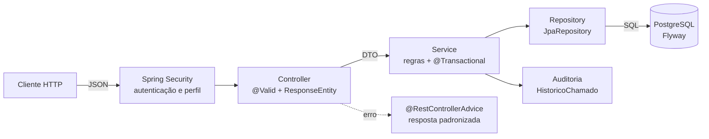
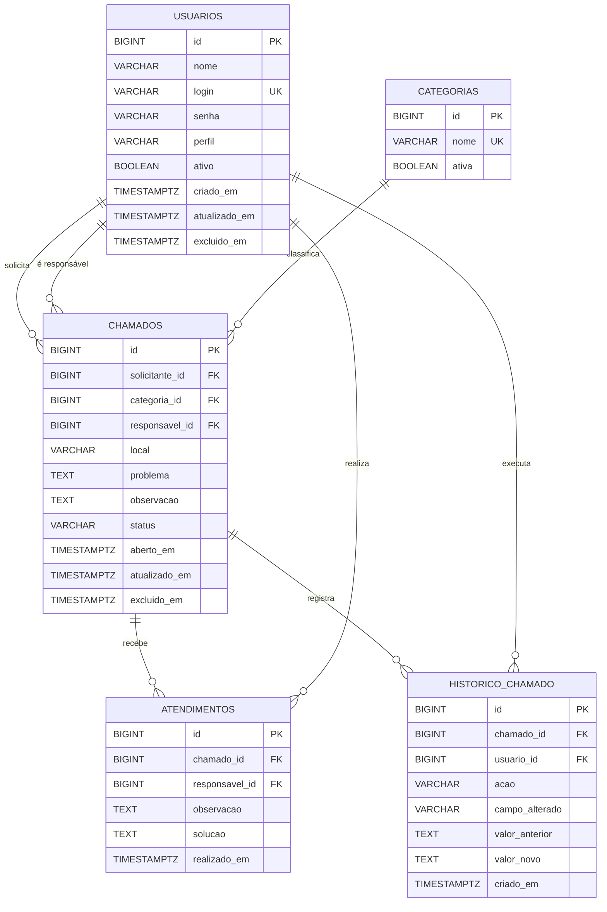
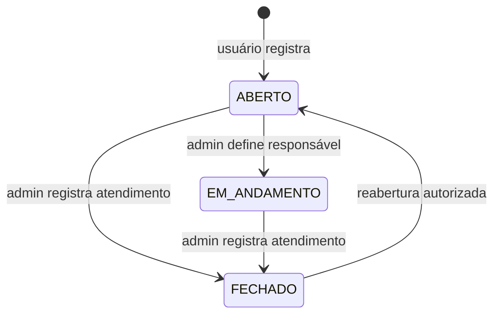
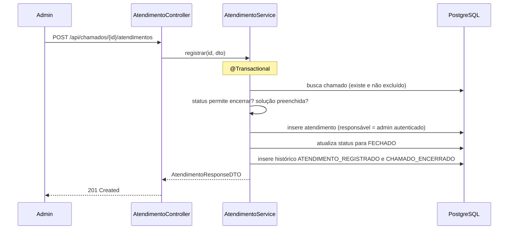

# Arquitetura — Sistema de Gerenciamento de Chamados de TI

API REST em camadas: o Controller recebe a requisição, o Service aplica as regras de negócio dentro de uma transação e o Repository acessa o PostgreSQL. Toda alteração relevante gera um registro de auditoria.

Fonte dos requisitos: [`docs/Documentacao_Tecnica_Sistema_Chamados_TI.txt`](docs/Documentacao_Tecnica_Sistema_Chamados_TI.txt) (versão 1.0). Em caso de conflito, a documentação técnica prevalece e a diferença é registrada em [`MEMORY.md`](MEMORY.md).

## 1. Visão geral das camadas



| Camada | Pacote | Responsabilidade | Não faz |
| --- | --- | --- | --- |
| Config | `config` | `SecurityConfig`, `PasswordEncoder` (BCrypt), configurações gerais | Regra de negócio |
| Controller | `controller` | Recebe a requisição, valida o DTO com `@Valid`, chama o service, devolve `ResponseEntity` | Acessar repository, decidir regra |
| DTO | `dto/*` | Records de entrada (`RequestDTO`) e saída (`ResponseDTO`) | Expor entidade JPA |
| Validation | `validation` | Regras de validação reutilizáveis e validadores próprios | Persistir dados |
| Service | `service` | Regras de negócio, transação, auditoria, identificação do usuário autenticado | Montar resposta HTTP |
| Repository | `repository` | Interfaces `JpaRepository`, consultas derivadas e filtros paginados | Regra de negócio |
| Model | `model` | Entidades JPA | Lógica de apresentação |
| Enums | `enums` | `Perfil`, `StatusChamado`, `AcaoHistorico` | — |
| Exception | `exception` | Exceções de negócio e handler global | — |

## 2. Pacotes

```
com.sistema.chamados
├── ChamadosApplication
├── config
├── controller
├── service
├── repository
├── model
├── dto
│   ├── auth
│   ├── usuario
│   ├── chamado
│   └── atendimento
├── validation
├── enums
└── exception
```

A árvore final será consolidada na Etapa 10, refletindo as classes realmente criadas.

## 3. Perfis e permissões

| Funcionalidade | `ROLE_USER` | `ROLE_ADMIN` |
| --- | --- | --- |
| Abrir chamado | Sim | Sim |
| Consultar chamados | Somente próprios | Todos |
| Visualizar detalhes | Somente próprios | Todos |
| Atualizar chamado | Não | Sim |
| Alterar status | Não | Sim |
| Definir responsável | Não | Sim |
| Excluir chamado | Não | Sim |
| Registrar atendimento | Não | Sim |
| Encerrar chamado | Não | Sim |
| Cadastrar, atualizar e excluir usuário | Não | Sim |
| Histórico de atendimentos | Não | Sim |
| Visualizar perfil | Sim | Sim |
| Histórico pessoal | Sim | Sim |

Regras:

- A autorização é aplicada no backend. Esconder botões na interface não é segurança.
- O solicitante e o autor de cada operação vêm do contexto de segurança, nunca do corpo da requisição.
- Usuários excluídos logicamente (`ativo = false` ou `excluido_em` preenchido) não autenticam.

## 4. Modelo de dados



### 4.1 Entidades e mapeamento JPA

| Entidade | Tabela | Relacionamentos | Observações |
| --- | --- | --- | --- |
| `Usuario` | `usuarios` | — | `perfil` como enum `Perfil` (`USER`, `ADMIN`); senha BCrypt; exclusão lógica |
| `Categoria` | `categorias` | — | `ativa = false` impede uso em chamados novos |
| `Chamado` | `chamados` | `@ManyToOne` solicitante, responsável e categoria; `@OneToMany` atendimentos e histórico | `status` como enum `StatusChamado`; exclusão lógica |
| `Atendimento` | `atendimentos` | `@ManyToOne` chamado e responsável | Nunca sobrescrito; `solucao` obrigatória |
| `HistoricoChamado` | `historico_chamado` | `@ManyToOne` chamado e usuário | Gerado só pelo backend; nunca alterado |

Cuidados (seção 14.3 da documentação):

- Sem `CascadeType.REMOVE` em entidades com histórico.
- Sem exclusão física de chamados, atendimentos ou auditoria.
- `FetchType.LAZY` nos `@ManyToOne`; consultas com `JOIN FETCH` ou `@EntityGraph` para evitar N+1.
- Datas preenchidas com `@PrePersist` e `@PreUpdate`.
- Chaves estrangeiras com `ON DELETE RESTRICT`.

### 4.2 Enums

| Enum | Valores |
| --- | --- |
| `Perfil` | `USER`, `ADMIN` (autoridades `ROLE_USER`, `ROLE_ADMIN`) |
| `StatusChamado` | `ABERTO`, `EM_ANDAMENTO`, `FECHADO` |
| `AcaoHistorico` | `CHAMADO_ABERTO`, `CHAMADO_ATUALIZADO`, `STATUS_ALTERADO`, `RESPONSAVEL_ALTERADO`, `ATENDIMENTO_REGISTRADO`, `CHAMADO_ENCERRADO`, `CHAMADO_EXCLUIDO`, `CHAMADO_REABERTO` |

### 4.3 Categorias iniciais

Inseridas por migration: Impressora; Rede / Internet; Computador / Notebook; Periférico ou cabo com defeito; Sistema / Software; Acesso ou senha; Solicitação de material ou equipamento; Outro.

### 4.4 Migrations planejadas

| Arquivo | Conteúdo |
| --- | --- |
| `V1__create_usuarios.sql` | Tabela `usuarios` + `CHECK` do perfil |
| `V2__create_categorias.sql` | Tabela `categorias` |
| `V3__create_chamados.sql` | Tabela `chamados` + FKs + `CHECK` do status |
| `V4__create_atendimentos.sql` | Tabela `atendimentos` + FKs + `CHECK` da solução |
| `V5__create_historico.sql` | Tabela `historico_chamado` + FKs |
| `V6__insert_categorias.sql` | Carga das 8 categorias |

O SQL de referência está na seção 23 da documentação técnica. Os índices entram junto da tabela correspondente.

## 5. Fluxos principais

### 5.1 Ciclo de vida do chamado



### 5.2 Abertura de chamado

1. Usuário autenticado envia `local`, `categoriaId`, `problema`, `observacao`.
2. Service obtém o solicitante do contexto de segurança.
3. Service confere se a categoria existe e está ativa.
4. Entidade recebe `status = ABERTO` e `aberto_em` automático.
5. Chamado é salvo.
6. Auditoria registra `CHAMADO_ABERTO`.
7. Tudo em uma transação; resposta `201 Created`.

### 5.3 Encerramento (registro de atendimento)



Se qualquer passo falhar, a transação inteira é desfeita.

### 5.4 Proteção do último administrador

Antes de desativar um `ADMIN`, o service conta os administradores ativos dentro da transação, com bloqueio (`@Lock(PESSIMISTIC_WRITE)` na consulta). Se houver só um, a operação é recusada com `409 Conflict`.

## 6. Endpoints planejados

Prefixo `/api`. A lista final será fechada na Etapa 6.

| Método | Rota | Perfil | Descrição |
| --- | --- | --- | --- |
| POST | `/api/auth/login` | Público | Autenticação |
| GET | `/api/usuarios/me` | USER, ADMIN | Perfil do usuário autenticado |
| GET | `/api/usuarios/me/chamados` | USER, ADMIN | Histórico pessoal (paginado) |
| GET | `/api/usuarios` | ADMIN | Lista de usuários (paginada) |
| GET | `/api/usuarios/{id}` | ADMIN | Detalhe do usuário |
| POST | `/api/usuarios` | ADMIN | Cadastro de usuário |
| PUT | `/api/usuarios/{id}` | ADMIN | Atualização de dados |
| PATCH | `/api/usuarios/{id}/senha` | ADMIN | Alteração de senha (fluxo próprio) |
| DELETE | `/api/usuarios/{id}` | ADMIN | Exclusão lógica |
| GET | `/api/categorias` | USER, ADMIN | Categorias ativas |
| POST | `/api/chamados` | USER, ADMIN | Abertura de chamado |
| GET | `/api/chamados` | USER (próprios), ADMIN (todos) | Lista com filtros e paginação |
| GET | `/api/chamados/{id}` | USER (próprio), ADMIN | Detalhe do chamado |
| PUT | `/api/chamados/{id}` | ADMIN | Atualização administrativa |
| PATCH | `/api/chamados/{id}/status` | ADMIN | Alteração de status |
| PATCH | `/api/chamados/{id}/responsavel` | ADMIN | Definição de responsável |
| DELETE | `/api/chamados/{id}` | ADMIN | Exclusão lógica |
| POST | `/api/chamados/{id}/atendimentos` | ADMIN | Registro de atendimento e encerramento |
| GET | `/api/atendimentos` | ADMIN | Histórico de atendimentos com filtros |
| GET | `/api/chamados/{id}/historico` | ADMIN | Auditoria do chamado |

Paginação: `?page=0&size=10&sort=abertoEm,desc`. A resposta traz conteúdo, número da página, tamanho, total de páginas e total de elementos.

Filtros de chamados: `id`, `solicitante`, `categoriaId`, `status`, `responsavelId`, `dataInicial`, `dataFinal`.

## 7. Tratamento de erros

Um `@RestControllerAdvice` converte exceções em respostas padronizadas.

| Situação | HTTP | Origem |
| --- | --- | --- |
| Operação realizada | 200 | — |
| Registro criado | 201 | — |
| Dados inválidos | 400 | `MethodArgumentNotValidException`, `RegraNegocioException` |
| Não autenticado | 401 | Spring Security |
| Sem permissão | 403 | Spring Security / `AccessDeniedException` |
| Registro inexistente | 404 | `RecursoNaoEncontradoException` |
| Conflito de dados | 409 | `ConflitoException` (login duplicado, último admin) |
| Erro interno | 500 | Demais exceções |

Formato da resposta de erro:

```json
{
    "timestamp": "2026-11-15T10:00:00-04:00",
    "status": 400,
    "erro": "Dados inválidos",
    "mensagem": "A categoria informada está inativa.",
    "caminho": "/api/chamados",
    "campos": [
        { "campo": "problema", "mensagem": "não deve estar em branco" }
    ]
}
```

A resposta nunca expõe senha, SQL, stack trace ou detalhes internos.

## 8. Auditoria e transações

- Atendimento e auditoria são registros diferentes e preservados separadamente.
- Atendimento: o que foi feito para resolver (observação, solução, responsável, data).
- Auditoria: o que mudou no sistema (quem, ação, campo, valor anterior, valor novo, data).
- `@Transactional` fica nos métodos de service que alteram mais de uma entidade.
- Métodos de leitura usam `@Transactional(readOnly = true)`.

## 9. Decisões em aberto

Registradas em [`MEMORY.md`](MEMORY.md#decisões-pendentes). A principal: autenticação por sessão ou JWT, a definir antes da Etapa 7.
